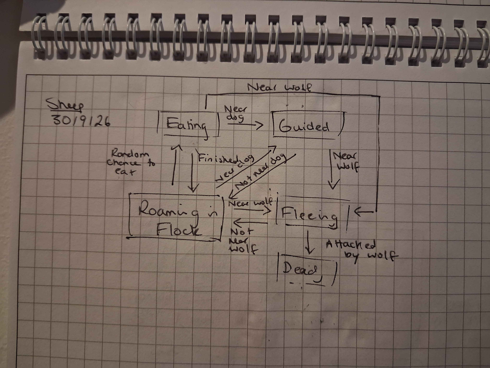
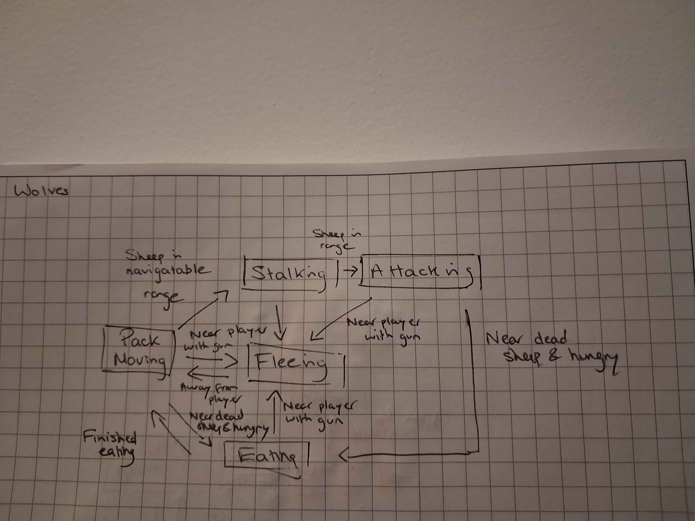
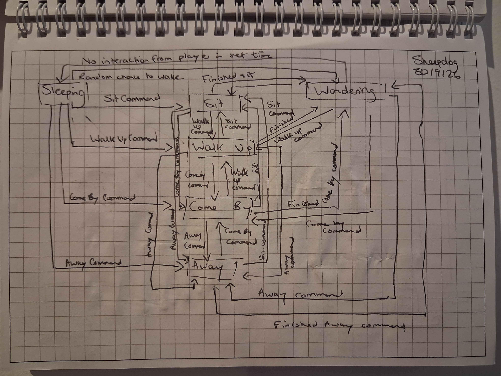
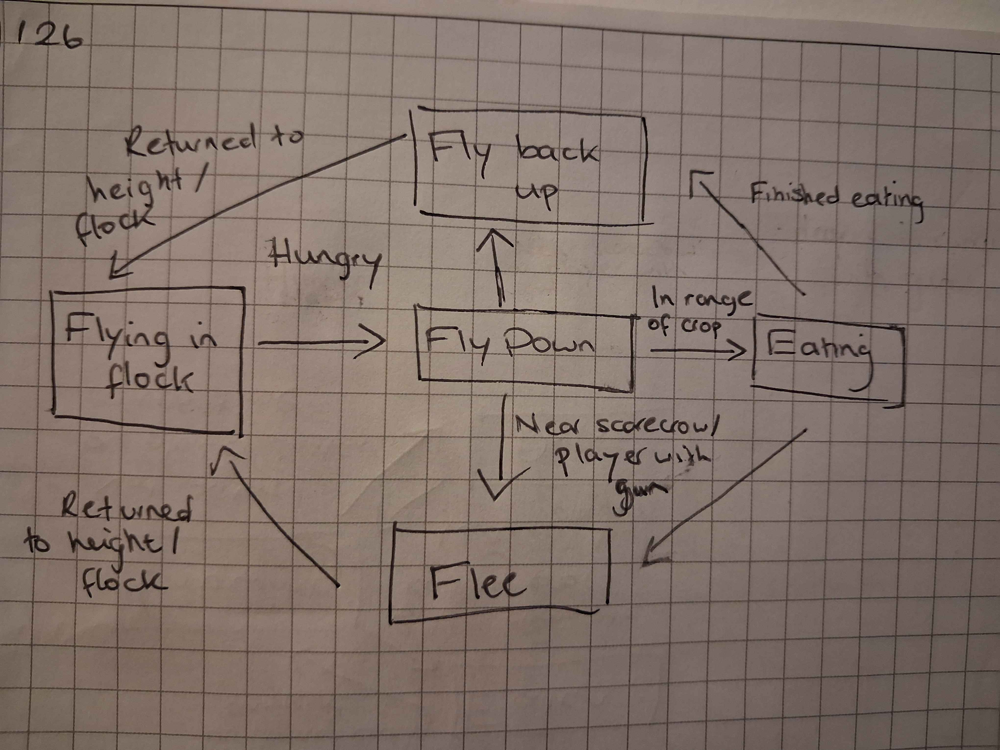
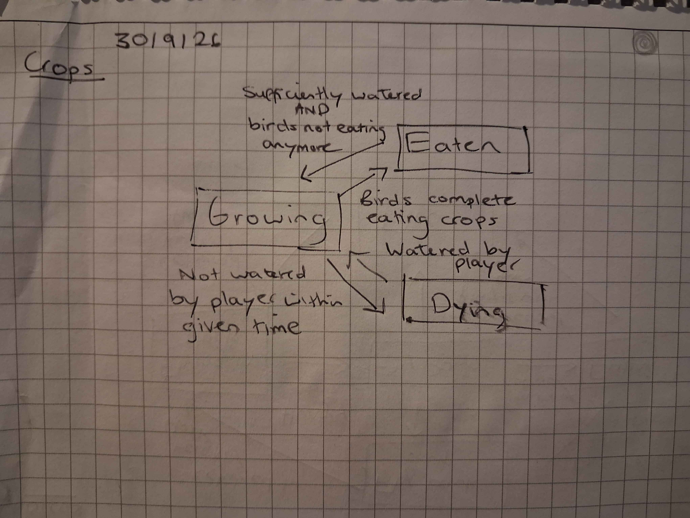

# CMP6206 - AI For Games Repo

Project Name: Farming Simulator

## Overview

A farm scene where the player can interact with growing plants and animals that each have different behaviours and can interact with each other.

- Sheep:
  - Behaviour:
    - Flocking/Roaming - main state of sheep occupying pen
    - Eating - chance to do this while roaming in pen
    - Ramming fence - chance to do this while roaming pen, will not do this while wolf near, potentiall will add feature to learn to not do this if it results in wolf attack
    - Fleeing - response to being in navigatable range of wolf
    - Dying - response ot being attacked by wolf
    - Guided - movement dictated by interaction with sheepog
  - Implementation method: Behaviour Tree

- Wolves:
  - Behaviour:
    - Pack moving - main state of wolves around scene
    - Stalking - will follow sheep when in navigatable range
    - Attacking - when sheep is in range
    - Eating - when in range of dead sheep
    - Fleeing - if in range of player while holding gun
  - Implementation method: GOAP: Goal is to eat all sheep, using behaviour tree

- Sheepdog:
  - Behaviour:
    - Wandering - main state of dog around scene
    - Commanded by player - player will have option of different commands which will dictate the sheepdog's movement
      - "Come By" - move clockwise around flock
      - "Away" - move anticlockwise around flock
      - "Sit" - stop moving
      - "Walk up" - walk towards flock
    - Sleeping - if not interacted with by player for certain time, while sleep somewhere in scene
  - Implementation: FSM

- Bird:
  - Behaviour:
    - Flying in flock - main state of birds in scene
    - Eating crops - will be triggered as birds hunger stat decreases over time
    - Returning to sky: once bird completes eating acyion, hunger stat will be replenished and bird will return to the sky
    - Fleeing: if bird flies down to eat crops and is within range/ line of sight of scarecrow/player they will fly away
  - Implementation method: Boids & FSM

- Crops:
  - Behaviour
    - Growing: main state of crops in state
    - Eaten: if crow successfully eats crop object, crop will lose height
    - Dying: if player has not watered crop for certain time, crop will enter dying state and start losing height
  - Implementation method: FSM

## Target Game Engine

Unity (appropriate .gitignore included)

## Research

### Sheepdog Behaviour

Common commands:

- "Come By": move clockwise around flock
- "Away" - move anticlockwise around flock
- "Sit" - stop moving
- "Walk up" - walk towards flock

### Sheep Behaviour

## Methodology / Planning

### Development

This project's timeline is being planned across two documents. I am using a Word document to track the general topics listed in the assessment brief that I want to look into throughout the semester and a table to plan out the broad timeline of when I aim to compete each feature. As I work through these features, I will then breakdown these features into smaller subtasks on a Notion kanban board to work through. This will define specifics for the implementations of each feature and the timeline in which I expect to complete them within.

### Quality Assurance

#### Linting

To ensure code standards are consistent across project (currently researching which tools to use).

#### Unit Testing

Will be set up with **Unity Test Runner** to test individual parts of logic from agents in specifically set up scenes *(e.g set scenarios to test dog's pathfinding in different conditions: player starts in sight, player starts out of sight, player is lost during pathfinding, player is unreachable player is out of bounds etc. )*

#### Playtesting

Having other people play in the scene and gain external feedback on the feel from th agents' behaviours to get next steps for further refinements.

### Progress Documentation

This will be documented in my Github commits to track what was completed in each commit, any current issues with the implementation and what date this was completed on. My Notion Kanban will also be updated with the progress from these commmits and if any features are completed before/after the expected time in the initial plan.

## References

### Assets

- [Sheep Models (not animated)](https://hattylaird.itch.io/silly-sheep-set) -License free to use
- [Grass Texture](https://www.magnific.com/free-vector/green-abstract-shapes-pattern_852278.htm#fromView=keyword&page=1&position=4&uuid=144e49d5-8826-40c7-b455-ae5671cbead4&track=ais_hybrid&query=Cartoon+grass+texture) - Designed by Dotstudio / Freepik (free to use for commercial use)
- [First Person Character Controller](https://assetstore.unity.com/packages/p/first-person-third-person-character-controllers-196526) by unity Technologies
- [Icons](https://kenney.nl/assets/game-icons)

### Tutorials

- [Line of Sight](https://www.youtube.com/watch?v=znZXmmyBF-o&themeRefresh=1)
- [A* Pathfinding Series](https://www.youtube.com/watch?v=3Dw5d7PlcTM)
- [Unity NavMesh Series](https://www.youtube.com/watch?v=SMWxCpLvrcc&list=PLX2vGYjWbI0SsXFD1Gjo-8kFEpzk5k4Kh&index=1)

### Research Resources

- Banham Sheepdogs
  - [Sheepdog Commands & Tools](https://www.banhamsheepdogs.co.uk/sheepdog-commands-tools/)
  - [Livestock Behaviour & Safety](https://www.banhamsheepdogs.co.uk/livestock-behaviour-and-safety/)
- [Sheep101](https://www.sheep101.info/flocking.html)
